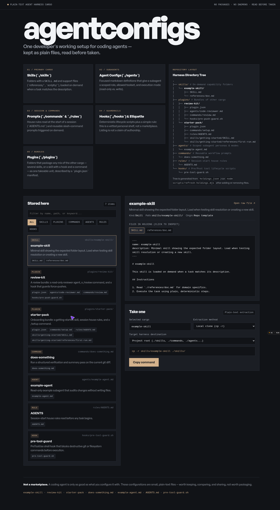

# agentconfigs

Personal storage and showcase for coding-agent configurations — kept as plain text
inside this repo, not installed into any agent harness.



The repository stores four kinds of cargo and serves a single-file landing page on top
that lets you browse, preview, and copy them out.

## Cargo folders

A **plugin** is a bundle: a folder under `plugins/` containing any mix of the other kinds,
mirroring the repo layout inside itself, plus a `plugin.json` manifest:

```
plugins/
  review-kit/
    plugin.json                # name, version, description
    agents/code-reviewer.md
    commands/review.md
    hooks/pre-push-guard.sh
```

| Folder        | Kind      | Form                                             |
| ------------- | --------- | ------------------------------------------------ |
| `skills/`     | Skill     | A folder with a `SKILL.md` and support files.    |
| `plugins/`    | Plugin    | A folder bundling any mix of the other kinds, with a `plugin.json` manifest. |
| `agents/`     | Agent     | A single `.md` file describing a subagent role.  |
| `commands/`   | Command   | A single `.md` file for a slash-command prompt.  |
| `rules/`      | Rule      | A single `.md` file (typically `AGENTS.md`).     |
| `hooks/`      | Hook      | A single `.sh` file for a lifecycle hook.        |

## Landing page

`./index.html` is the only page. It is fully static, has no build step, and loads
its catalogue from `./holdings.json` at runtime.

To add or remove a holding:

1. Create or delete the folder/file under its cargo folder above.
2. Re-run `node scripts/refresh-holdings.mjs` to regenerate `holdings.json`.
3. Commit. Refresh the page.

## Local preview

```sh
node scripts/refresh-holdings.mjs
python3 -m http.server 8099
# open http://127.0.0.1:8099/
```

## Not a marketplace

Listing a skill here is not a claim of authorship. Everything is read before it is
taken. See `IDEA.md` for the longer version of what this project is for.
